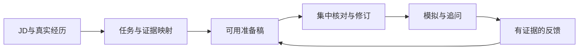

# Interview Master

**把真实经历变成能讲清、能追问、能练习的面试准备。**

面向 **Codex、WorkBuddy、Claude 及支持 Agent Skills 的 Agent** 的通用面试 Skill。同一份技能包，按目标岗位生成完整答案和工作样本，也能作为教练开展多语言、可调强度的模拟面试。

[English](README.en.md) · [安装与兼容](docs/compatibility.md) · [能力提升说明](docs/capability-upgrade-v4.md) · [Codex验收](evals/reports/codex-acceptance.md) · [贡献](CONTRIBUTING.md)

> **当前：v4.0.0-rc.2，本地候选版，等待维护者验收。** 尚未推送或发布到 GitHub。宿主实测与格式兼容分别记录，不承诺所有模型效果相同。

## 一句话开始

安装后，把JD和经历交给你的Agent：

```text
用 interview-master 帮我准备这份岗位。
完整准备模式，中文讲解、英文答案。
先给可用初稿和针对性问题的完整答案，再集中核对关键事实。
不要把我参与的工作写成主导；不确定的数字保持未知。
```

你会得到岗位重点、经历证据、自我介绍、项目回答、针对性题目与答案，以及下一步练习。需要先补充什么，由已有材料决定，不要求先填完整问卷。

## 选择适合你的节奏

| 你的需求 | 模式 | 先得到什么 |
|---|---|---|
| “明天面试，只有40分钟” | 冲刺 | 重点风险、可直接练的答案、速记 |
| “一次给我完整准备包” | 完整准备 | 可用正文，随后集中核对事实 |
| “先讲清原理，再让我练” | 教练 | 方法、完整示范、取舍与练习 |
| “现在开始压力面” | 模拟 | 逐题追问，依据实际回答调整 |

也可以直接要自我介绍、简历修改、反问、面后复盘、谈薪或Offer比较。输出选择 **问题 / 提纲 / 完整答案 / 学习包**；压力选择标准、强化或高压，和准备模式独立。

## 同一份包，多种Agent

| Agent | 安装入口 | 验证说明 |
|---|---|---|
| Codex | 项目 `.agents/skills/interview-master/` | CLI项目安装与10项有限检查通过；结果与证据见[报告](evals/reports/codex-acceptance.md) |
| WorkBuddy | 技能管理 → 添加技能 → 上传本地技能包 | 官方导入方式已核对；未做客户端实跑 |
| Claude | 按官方技能界面导入完整ZIP | 保留使用方式；未做本版客户端实跑 |
| 其他支持Agent Skills的Agent | 其技能目录或包导入入口 | 格式可复用，需验证发现、引用读取与行为 |

安装的是整个 `interview-master/` 文件夹，包含 `SKILL.md` 与 `references/`。不需要更改Skill正文以切换宿主，也不依赖专用API、MCP服务或运行时脚本。[分宿主安装和排错](docs/compatibility.md)

**Codex项目级安装后的验证请求：**

```text
使用本项目的 interview-master，说明实际读取的技能入口。
我想用中文理解思路、用英语练习面试。请从一道相关问题开始。
```

有同名旧版时选中项目安装路径，避免误用。当前候选包先在本地构建，用户验收后才推送；不要把远端现有正式版当作本候选版本。

## 多语言，保留同一套事实

讲解语言、答案语言、模拟语言可以分别设置；中途切换保留当前题目和事实状态。招聘市场独立指定，英文不自动等于美国岗位。

```text
中文解释，给自然、能说出口的英文答案。
Interview me in English. Give feedback in Chinese when we finish.
Prepare everything in English, including headings and examples.
Ahora solo español. Continúa con la pregunta pendiente.
```

“参与”不会因润色升级为“主导”；15%到18%是3个百分点，不能变成3%。专业判断与语言清晰度分开反馈。文字输入不能证明发音、眼神或真实语速。中英、西语、法语有已审阅样例；其他语种效果依赖宿主模型，未获母语质量认证。

## 不只出题，也教怎么解决

| 岗位方向 | 重点训练 | 完整工作样本 |
|---|---|---|
| 产品 | 问题判断、优先级、验证、协作 | [权限体验与产品决策](references/examples/product_decision.md) |
| 运营 / 增长 | 分层、执行、成本、留存、归因 | [活动扩量决策](references/examples/operations_growth.md) |
| 数据分析 | 指标口径、SQL、实验、业务解释 | [总体与渠道指标冲突](references/examples/data_diagnosis.md) |
| 技术 | 后端、前端、移动、AI应用工程 | [数据迁移](references/examples/backend_migration.md)、[客户端状态](references/examples/frontend_mobile.md) |
| AI产品 | 任务价值、自治范围、人审、评测 | [AI工作流](references/examples/ai_workflow.md) |
| 管理 | 资源取舍、依赖、反馈、团队机制 | [资源与交付决策](references/examples/management_decision.md) |

每个方向包含方法、完整示范、替代方案、失败变化和层级标准。其他岗位可做JD适配，但尚未建立同等深度的专门模块。[覆盖目录](references/role_catalog.md)

## 看一个具体变化

合成经历：“参与入门清单协调，工程团队负责代码；简历记录转化15%到18%，因果未核实。”

可练习的英文表达：

> I contributed to coordinating the onboarding checklist, while engineering was responsible for the code. My résumé reports conversion rising from 15% to 18%, a 3-percentage-point increase. I cannot establish that the checklist caused that change.

接着练“具体协调了什么”和“怎样验证效果”，而不是为缺失数字补造业绩。[完整语言与暂停样例](evals/outputs/fresh-package-language-pause.md)



## 验证到了哪一步

- 结构与发布：17项自动测试；引用图、包内依赖和确定性构建检查。
- 行为：rc.1的36类场景、8份v3基线、6组岗位双版本对照及2份独立包场景，共58份已审阅输出。
- 宿主：rc.2直接安装到Codex项目技能目录，运行记录见[Codex验收报告](evals/reports/codex-acceptance.md)。

已有对照中v3也能首轮给出好答案，未证明v4稳定提速或提高录用率。本次改进的明确机制和证据见[能力提升说明](docs/capability-upgrade-v4.md)。

## 常见问题

**没有联网或不能保存文件？** 基于已提供材料继续；研究缺口标明，正文与续接摘要可在聊天交付。

**模拟时想看答案？** 说“暂停，先解释并示范”。恢复后会保留当前题目，已看示范的回答作为引导练习。

**能保证面试通过吗？** 不能。材料生成、实际练习、已观察能力是三件事，也不会将模拟分数变成录用概率。

**更新会改我的简历吗？** Skill文件与候选人资料应分开存放。升级只替换技能包；已投递版本和用户修改保留。[迁移与回退](docs/migration-v4.md)

## 开发与贡献

在仓库根目录构建候选包：

```sh
python3 -m unittest discover -s tests -v
python3 scripts/validate_repository.py
python3 scripts/build_release.py --version 4.0.0-rc.2 --output-dir dist
```

产物为 `dist/interview-master-v4.0.0-rc.2.zip`。开发文档、评测、会话与用户资料不进入运行包。

欢迎提交可复现问题、语言修正和有完整解法的岗位模块。[贡献指南](CONTRIBUTING.md) · [路线图](docs/roadmap.md) · [版本记录](CHANGELOG.md) · [21项目调研](docs/source-notes.md) · [说明设计依据](docs/readme-design-notes.md)

MIT License。外链资料保留各自许可。候选人事实不应进入公开仓库，Skill不会自行申请岗位、联系他人或发布材料。
